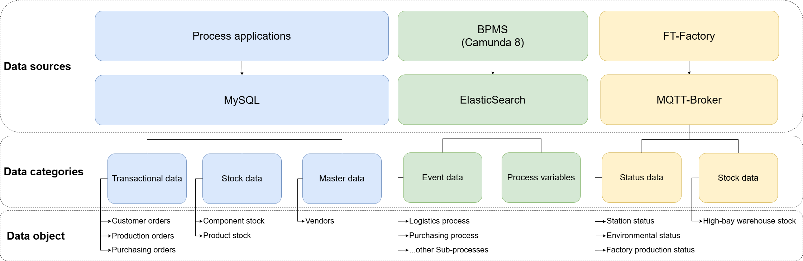
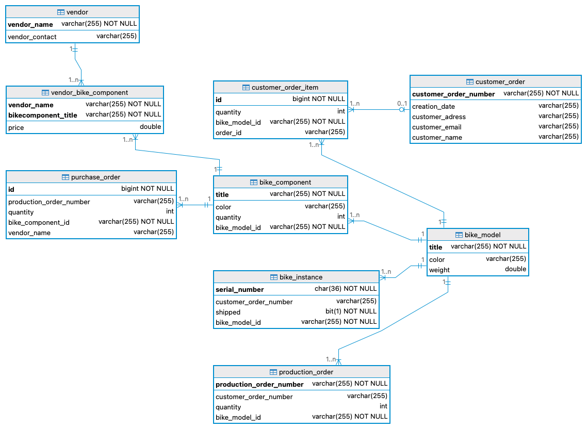

## Overview of data sources

The BPA Lab integrates data from several sources — from **master data** in a relational database, via **process state** maintained by the workflow engine, to **sensor and telemetry data** from the Fischertechnik components.

The following figure gives an overview of the main data sources and the kinds of data they hold:

{#fig-data-overview fig-align="center"}

## The MySQL data model

The following diagram shows the concrete data model of the MySQL database, including the entities and attributes of the current implementation:

{#fig-mysql fig-align="center"}

The database serves as the central store for:

- **Product master data** — bicycle models and their components,
- **Customer data** and delivery addresses,
- **Stock levels** for components and finished goods,
- **Orders** — customer orders, production orders, purchase orders — together with their status history,
- **Vendor data**.

## Sample and master data

Documentation and sample data of the Fischertechnik factory are available in the [`Sample_data`](https://github.com/BpaLabTHCologne/bpa_lab_docs/tree/main/Sample_data) folder of the documentation repository. This data serves as:

- **initial master data** when setting up a new instance of the BPA Lab,
- **test data** for developing new components,
- a **demonstration baseline** for teaching sessions and presentations.

## Process data and the foundation for process mining

In addition to persistent master data, the running processes generate substantial amounts of **process data**:

- **Camunda 8** stores process instance data, variables, tokens, and lifecycle events.
- **MQTT messages** record the communication between job workers and controllers.
- **Job worker logs** capture technical operations and exceptions.

This event data is the foundation for **process mining** — a central teaching and demonstration component of the BPA Lab. Process mining allows students to:

- **discover** the actual flow of processes from event logs (and compare them to the modelled flow),
- **check conformance** between modelled and actual behaviour,
- **analyse performance** — durations, bottlenecks, rework loops.

## Topics and Payloads

The following list shows the messages accepted or sent by the **Fischertechnik Factory** (not exhaustive)

### Messages send from FT-Factory

**Topic: bpalab/ftfactory/f/i/order**

    {"ts": "2025-07-31T10:57:42.953Z",
    "state": "ORDERED",
    "type": "WHITE",
    "processOrderReference": "None"
    }

**Topic: bpalab/ftfactory/f/i/stock**

    {"ts":"2023-06-22T12:m12:12.123",
     "stockItems": 
        [{"workpiece": { "id":"123456789ABCDE", "type":"WHITE", "state":"RAW" }, "location":"A1"},
         {"workpiece": { "id":"156789ABCDE", "type":"RED", "state":"RAW" }, "location":"A2"},
         {"workpiece": { "id":"7765555", "type":"BLUE", "state":"RAW" }, "location":"A3"},
         { "workpiece":null, "location":"B1"},
         { "workpiece":null, "location":"B2"},
         { "workpiece":null, "location":"B3" },
         { "workpiece":null, "location":"C1"},
         { "workpiece":null, "location":"C2"},
         { "workpiece":null, "location":"C3" }] }

**Topic: bpalab/ftfactory/i/ldr**

    {"ts": "2025-07-31T10:58:03.299Z",
    "br": 82.2,
    "ldr": 11575
    }

**Topic: bpalab/ftfactory/i/bme680**

    {"ts": "2025-07-31T10:57:23.356Z",
    "t": 24.6,
    "rt": 0,
    "h": 39,
    "rh": 0,
    "p": 1000.7,
    "iaq": 3,
    "aq": 3,
    "gr": 0
    }

**Topic: bpalab/ftfactory/f/i/state/vgr**

    {"ts": "2025-07-31T10:57:24.089Z",
    "station": "vgr",
    "code": 1,
    "active": 0,
    "target": ""
    }

**Topic: bpalab/ftfactory/f/i/state/dsi** 

    {"ts": "2025-07-31T10:57:16.647Z",
    "station": "dsi",
    "code": 1,
    "active": 0
    }

**Topic: bpalab/ftfactory/f/i/state/sld**

    {"ts": "2025-07-31T10:57:18.509Z",
    "station": "sld",
    "code": 1,
    "active": 0
    }

**Topic: bpalab/ftfactory/f/i/state/dso**

    {"ts": "2025-07-31T10:57:24.709Z",
    "station": "dso",
    "code": 1,
    "active": 0
    }

**Topic: bpalab/ftfactory/f/i/state/hbw**

    {"ts": "2025-07-31T10:57:25.962Z",
    "station": "hbw",
    "code": 2,
    "active": 1
    }

**Topic: bpalab/ftfactory/f/i/state/sld**

    {"ts": "2025-07-31T10:57:28.773Z",
    "station": "sld",
    "code": 1,
    "active": 0
    }

**Topic: bpalab/ftfactory/f/i/state/mpo**

    {"ts": "2025-07-31T10:57:34.871Z",
    "station": "mpo",
    "code": 1,
    "active": 0
    }

### Messages send to FT-Factory

Sample BROADCAST publish:

(send to activate the publisher of FT-Factory)

**Topic: bpalab/ftfactory/o/broadcast**

    {"ts":"2023-06-05T15:20:41.613", "message":"keep-alive"}

Sample ORDER publish:

**Topic: bpalab/ftfactory/f/o/order**

	{"ts":"2026-06-18T08:56:50.022Z","type":"RED","processOrderReference":"00000099-99"}
